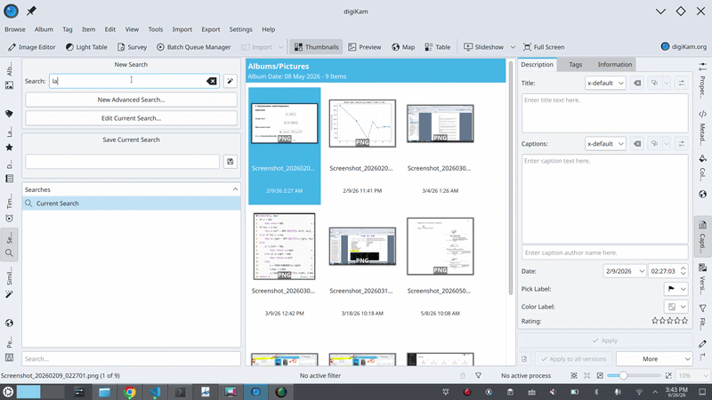

*GSoC 2026 • digiKam • Post 1: Design and Progress*

I've been hanging around KDE apps since I was a teenager :), so getting to spend another summer inside one feels a bit like coming home. This time it's digiKam!

Here's what I want digiKam to do: Let me type "photos of mountains from last summer that I rated highly" into a search box, and have it just... find them. No complex filters, no guessing where to click, just plain English, the way you'd ask a friend who'd been on the trip with you.

That, in one sentence, is my GSoC project: interfacing digiKam's search engine with an AI-based **LLM** so you can search your photo collection in natural language. For many users, digiKam's **Advanced Search** is a hidden gem, powerful but a little intimidating. By adding natural language support, we're making it accessible to everyone, from beginners to experts who want to save time. And as someone who's used KDE apps for years, I loved the idea of bridging the gap between digiKam's powerful features and the simplicity of just *asking* for what you want.

I'd recently been deep-diving into transformers, and this project stood out to me as a near-perfect blend: real software development *and* having to actually understand LLMs, which architectures fit where, when you want an encoder versus a decoder, and how a model behaves once it's wired into an actual application.

This first post is about the overall design and the progress so far. The more interesting bits about the actual language model: which one, how fast, how accurate, are coming in a second post, so consider this the scene-setting.

*(Mild Technical Content Ahead, but I promise to keep the scary parts optional. ;) )*

**The one idea the whole project rests on**

DigiKam already has a powerful **Advanced Search** feature: a dialog packed with dropdowns for tags, dates, ratings, albums, color labels, and more. It can handle complex queries, but it requires users to know how to navigate it.

So the **LLM** in my project does NOT search your photos. Let me say that again, because it's the most important design decision: the model never touches your database, never decides what matches, never invents results. All it does is **translate** your sentence into the exact same structured query you could have built by clicking the dialog yourself. The model produces an "intent"; digiKam's existing, trusted search engine does the actual searching.

I like this framing because it keeps the AI firmly in its lane. The LLM is a translator sitting in front of a door that already exists: it's not a new door, and it definitely isn't allowed to wander off and make things up. Anything it produces is something a human could have produced by clicking. That's the safety guarantee, and everything in the pipeline is built to enforce it.

**The Pipeline in Action**

Here's the journey your query takes:

```
Your sentence
     |
     v
[ Prompt Builder ]  : wraps it with format instructions
     |
     v
[ Language Backend ]  : runs the model, returns raw output
     |
     v
[ Intent Parser ]  : validates strictly; rejects anything malformed
     |
     v
[ Capability Dictionary ]  : maps human words to digiKam's real fields
     |
     v
[ Intent Resolver ]  : builds concrete search criteria
     |
     v
Advanced Search widgets populated —> digiKam runs the search
```

Walking through it:

1. You type a sentence.
2. A **prompt builder** wraps it in instructions that tell the model exactly what format to answer in.
3. A **language backend** runs the model and gets back its answer.
4. An **intent parser** reads that answer and crucially *validates it strictly*. The model's output is never trusted directly. If it isn't well-formed and doesn't match the known fields and operators, it's rejected outright. No partial guessing.
5. A **capability dictionary** maps fuzzy human words to digiKam's real fields: "best" might mean a high rating or an "Accepted" pick label, "colour label" maps to the actual colour-label field, and so on.
6. An **intent resolver** turns the validated, mapped intent into concrete search criteria.
7. Those criteria populate the Advanced Search widgets, and digiKam runs the search exactly as if you'd filled them in by hand.

The nice consequence of splitting it up this way is that the model can be as small and dumb as we like, every layer after it is busy double-checking its homework. If the model says something nonsensical, the parser catches it. If it names a field that doesn't exist, the dictionary won't map it. By the time anything reaches your database, it's been laundered through several layers of "is this actually a thing digiKam can do?"

**Why Local Models?**

A quick but important detour. The model runs *locally* on your own machine, not in some company's cloud. Running the model locally isn't just about performance - it's about privacy.
 
And privacy matters more here than it might first appear. Think about what's actually in a photo library: where you live, who your family and friends are, where you travelled and when, the inside of your home, your children, the events that matter to you. A photo collection is one of the most personal things a person keeps on a computer. And the *searches* you run over it are revealing in their own right, the words you'd type to find a photo say something about what you're looking for and why.
 
If any of that were sent off to a remote server to be processed, you'd be trusting a third party with exactly the information most people would least want to hand over. Running everything on-device sidesteps that entirely: your photos never leave your machine, your queries never leave your machine, and there's no account, no API key, and no internet connection required. The feature works the same on a plane as it does at home.
 
The catch is that a local model is a big file you have to get onto people's computers somehow which brings me to the part I spent most of this period actually building.

**Plugging into digiKam's Infrastructure**

C++ has been my favourite language since my teens, and one of the quiet pleasures of this project has been getting to brush up on it properly. Qt, though, is a different story and a familiar one if you've read my Krita posts. Every term I spend with Qt I learn a little more, and every term I'm reminded that it's one of the harder frameworks to get comfortable in, precisely because it leans so heavily on design patterns. You don't really "learn Qt" so much as slowly stop being surprised by it.

When I first thought about "the model needs to be downloaded onto the user's computer," my instinct was to just write something that downloads a file. Simple enough. But that instinct was wrong. digiKam already knows how to download large model files. It's been doing it for years, for face recognition, object detection, auto-rotation, aesthetics scoring. There's a whole system for it: a central `DNNModelManager` that reads a config file describing each model, and a `FilesDownloader` that fetches the files from KDE's servers and verifies them. My mentor's guidance was clear and correct: don't build a parallel download mechanism, plug into this one.

The wrinkle is that this entire system was built for **OpenCV vision models** - models that look at images. My model is a **language model** run by a completely different library (llama.cpp). It's a different kind of beast that doesn't fit the OpenCV machinery at all.

The solution turned out to be pleasingly modular. By creating a lightweight `DNNModelNaturalLanguage` class, I was able to plug into digiKam's existing model download system without modifying its core logic. This means the GGUF file is downloaded, verified, and managed just like digiKam's other AI models (e.g., for face recognition). There's an existing model type in digiKam (`DNNModelConfig`) that registers and verifies a file but does no OpenCV loading and that was almost exactly the shape I needed, so my wrapper mirrors it. The actual loading and running of the model happens separately, in a `SearchLlamaBackend` that talks to llama.cpp.

So the division of labour is clean: digiKam's existing system handles *getting the file onto your computer* (download, checksum, the works), and my llama.cpp backend handles *running it*. No duplication, and my model gets to ride the same well-tested rails as every other model in digiKam.

**Why Qwen2.5-1.5B-Instruct**
 
A word on the model itself (much more in post two). I went with **Qwen2.5**-1.5B-Instruct, in a quantized GGUF form, for a few reasons:
 
- **Size vs. capability.** At ~1.12 GB (Q4_K_M quantization) it's small enough to download and run on a normal laptop, but the 1.5B-Instruct variant is genuinely good at following instructions and producing structured JSON, which is exactly what I need it to do.
- **It's good at the specific job.** This project lives or dies on the model reliably emitting clean, parseable, schema-shaped output. Qwen2.5 is notably solid at structured outputs.
- **The licence.** It's Apache 2.0, so it's freely redistributable, which means KDE can actually host the file on its own infrastructure.
**Why a decoder-only model (and not BERT)**
 
Before picking a *specific* model, I had to pick a *kind* of model and this is one of the places my transformers reading actually paid off, so indulge me for a paragraph.
 
The obvious-seeming choice for "understand a sentence and classify it" is an encoder model like BERT. Encoders are efficient, deterministic, and great at fixed-label tasks. But they assume a *finite, predefined output space* and that's exactly what search queries don't have. A query can express any number of constraints ("landscape photos with red labels near Paris last summer" is four constraints at once), and I'll keep adding new searchable dimensions over time. To force that into an encoder, I'd need a pile of auxiliary pieces: intent classifiers, entity extractors, rule-based combiners and that scaffolding gets more brittle every time digiKam gains a new search field.
 
A **decoder-only** model sidesteps all of that. It generates a *sequence*, so it can emit a variable number of structured constraints directly as JSON, following a schema I define in the prompt. New search field? Update the schema and no retraining. And it handles ambiguity gracefully: instead of being forced to pick one interpretation of "best photos," it can emit a clarification request inside the same constrained output. (Encoder-decoder models like T5 could generate structured output too, but they carry extra architectural and latency overhead that's wasteful for a local, on-demand desktop feature.)
 
So the short version: a small decoder-only model gives me compositional, schema-shaped generation with built-in ambiguity handling, at a size that runs on a laptop. That's the whole wishlist.
 
All assuming 4-bit (Q4) quantization in GGUF form, which is the standard for CPU inference with llama.cpp:
 
| Model | Params | Size (Q4) | Licence | Notes |
|-------|--------|-----------|---------|-------|
| **Qwen2.5-1.5B-Instruct** | 1.5B | ~0.9–1.2 GB | Apache 2.0 | Balanced quality/efficiency, good structured output, long context — **my primary** |
| TinyLlama 1.1B | 1.1B | ~0.7–0.9 GB | Apache 2.0 | Lightest, fast CPU inference — **fallback for low-RAM machines** |
| Gemma 2B Instruct | 2B | ~1.3–1.6 GB | (Gemma terms) | Strong general language understanding |
| Phi-2 | 2.7B | ~1.5–1.8 GB | MIT | Better reasoning than 1B models, heavier CPU load |
| Qwen2.5-3B-Instruct | 3B | ~1.8–2.2 GB | Apache 2.0 | More capable than 1.5B, but higher RAM |
| Phi-3 Mini | 3.8B | ~2.2–2.6 GB | MIT | Best comprehension here, but slowest and largest |
 
The pattern is a straightforward size-vs-capability trade-off. The bigger models (Phi-3 Mini, Qwen2.5-3B) reason better but want more RAM and run slower on a CPU-only laptop and since this feature has to stay usable on ordinary hardware without a dedicated GPU, "runs comfortably in ~1 GB of RAM" is a hard constraint, not a preference. That rules the heavier models out for the default.
 
Among the lightweight options, **Qwen2.5-1.5B-Instruct** hits the sweet spot: small enough for a CPU laptop, but notably reliable at the one thing this project actually needs: emitting clean, schema-shaped structured output. **TinyLlama 1.1B** stays in the picture as a fallback for lower-end machines where even 1.5B is too much. Both are Apache 2.0, which (as above) is what makes KDE hosting possible, a point that quietly eliminated some otherwise-tempting models with restrictive licences.

<p align="center">
  
</p>

**Where things stand**

The pipeline already works end-to-end using a mock backend (standing in for the real model). So, prompt > parse > resolve > populate-the-search-and-run is all functioning and unit-tested. And the download integration I described above is in place: the model is registered with digiKam's central manager, and I've verified it gets picked up correctly and its file path resolves to the shared model directory.

**What's Next?**

- Host the GGUF model on KDE's infrastructure (in progress).
- Wire up llama.cpp for local inference.
- Benchmark Qwen2.5 vs. TinyLlama on digiKam-specific queries (e.g., "5-star photos", "pick label accepted").
- Dive into model performance, fine-tuning, and caching!

Found an excuse to start drawing again :)

