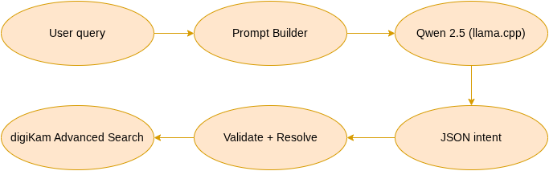
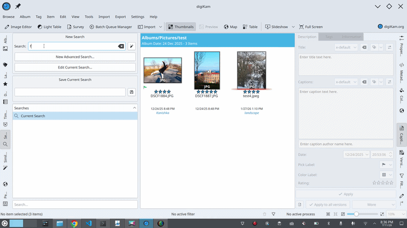

*GSoC 2026 • digiKam • Post 2: Inference, Bugs, and the Build*

In my first post, I introduced the goal: type a plain-English search into digiKam and have a local LLM translate it into structured search criteria. That post built the whole pipeline - prompt builder, JSON parser, intent resolver, against a mock backend that returned canned responses, so everything could be tested before a real model was wired in. This post is about swapping that mock for real llama.cpp inference, and everything that broke along the way, which was almost never the model.

At the end of my last post I promised that this one would be about the actual language model: which one, how fast, how accurate. I've been looking forward to writing it.

Here's the thing I did not expect. The model works. It has essentially always worked. Almost every hard problem I hit over the past few weeks lived *somewhere else*: in a compiler flag, in a JSON type, in a git server's opinions about submodules. This post is the honest version of what it takes to put a language model inside a desktop application, and the honest version is that the language model is the small part.

<p align="center">
  
</p>


**Actually running the thing**

Last time the pipeline ran end-to-end against a mock backend: something that returned canned answers so I could build and test everything around it. Replacing that mock with a real model meant writing `SearchLlamaBackend`, which loads a quantized Qwen2.5 GGUF through llama.cpp and generates tokens.

Two decisions shaped it.

The first decision was that **every single `llama_*` call happens on a worker thread**. Loading a 1 GB model takes a few seconds; generating tokens takes a few more. If any of that ran on the GUI thread, digiKam would freeze every time you searched. So the backend owns a `QThread`, the worker lives on it, and everything crosses the boundary through queued signals - the UI stays responsive while the model thinks.

Here's the shape of it (simplified from the real method, which has the error handling and tokenization removed for readability):

```cpp
void SearchLlamaWorker::slotDoInference(const QString& prompt, int maxTokens, float temperature)
{
    Q_UNUSED(temperature);   // greedy decoding, determinism over creativity

    llama_context*     const ctx   = static_cast<llama_context*>(m_context);
    const llama_vocab* const vocab = llama_model_get_vocab(/* ... */);

    // Start each query from an empty context.
    llama_memory_clear(llama_get_memory(ctx), true);

    // Greedy sampler: always pick the single most likely next token.
    llama_sampler* smpl = llama_sampler_chain_init(llama_sampler_chain_default_params());
    llama_sampler_chain_add(smpl, llama_sampler_init_greedy());

    QString result;

    while (generated < maxTokens)
    {
        llama_decode(ctx, batch);
        const llama_token tok = llama_sampler_sample(smpl, ctx, -1);

        if (llama_vocab_is_eog(vocab, tok)) break;

        result += /* decoded token text */;

        // Stop as soon as the JSON object closes (balanced braces).
        if (jsonObjectComplete(result)) break;
    }

    llama_sampler_free(smpl);
    Q_EMIT signalOutputReady(result);   // back to the main thread, via a queued signal
}
```

Two things in there are deliberate. `llama_memory_clear` at the top wipes the context's KV cache so every query starts fresh - I'll come back to why that one line matters more than it looks. And the sampler is **greedy**: no temperature, no randomness, the model always takes its single most likely token. That's the opposite of how you'd run an LLM writing prose, where a little randomness keeps it from sounding wooden. But I don't want prose. I want the *same query to give the same JSON every time* - so a bug is reproducible, and so the query cache from the last phase stores a real answer instead of one of several possible ones. For structured output, determinism isn't a limitation; it's the whole point.


**Knowing when to shut up**

A small problem I enjoyed solving. The model is supposed to emit one JSON object and stop. Sometimes it does. Sometimes it emits the object, decides it's on a roll, and keeps going, producing helpful commentary, a second example, and whatever else it feels like until it hits the token limit.

Generating tokens you're going to throw away is pure waste, and on a CPU each one costs real time. So the decode loop watches the output as it accumulates and counts brace depth. The moment the braces balance, meaning the first complete JSON object has closed, generation stops. In practice this cut a typical query from a hundred-plus tokens down to about twenty-two.

It's a heuristic, and I know its failure mode: a `}` inside a string value would fool it. My schema doesn't have string values that contain braces, so it holds. If that ever changes, the honest fix is to attempt a real parse each iteration and stop when it succeeds. I'd rather ship the simple thing that works and know exactly where it breaks.

<p align="center">
  
</p>

**Three bugs, none of them the model's**

Once real queries started flowing, things broke. Every single time, I assumed the small model was being dumb. Every single time, I was wrong.

**A rating of 5 kept vanishing.** I'd ask for five-star photos, watch the model emit perfectly correct JSON with `"value": 5` in it, and watch the rating field come out empty. The parser was calling `QJsonValue::toString()`, which returns an *empty string* when the value is a number rather than a string. Not an error. Not a warning. An empty string. The model had said `5`; my code heard silence.

The fix was to stop assuming. Instead of blindly calling `.toString()`, the parser now checks the JSON value's type first, string, number, or bool, and converts each properly (`QString::number()` for a number, and so on). One value arriving as `5` instead of `"5"` shouldn't be able to silently erase a search constraint, and now it can't.

**Dates never populated.** The model would emit a date. The date widget wanted a *range*, in the form `start..end`. Nobody had told the model that. This wasn't a bug in the model so much as a bug in the instructions I'd given it.

The fix was in the prompt, not the code. I added an explicit instruction: dates must always be a range in the form `2023-01-01..2023-12-31`, a whole year expands to its first and last day, a whole month to its month boundaries. Plus one worked example. Small models learn far more from a single concrete example than from three sentences of rules, and once the example was there, the ambiguity was gone.

**And then: "last year" meant 2022.**

This one is my favourite, because it's structural rather than accidental. I typed "photos from last year," expecting 2026. The model confidently produced 2022.

It wasn't guessing badly. **It has no clock.** A language model's sense of "now" is a fossil of whenever its training data was collected. It has no way to know what day it is, and this is the part that matters - no way to *know that it doesn't know*. So it answers with total confidence, and it's wrong, and nothing in its output looks any different from when it's right.

The fix is embarrassingly simple: tell it the date. The prompt now includes today's date and spells out the conversions explicitly: "last year" means such-and-such a range. It works.

But I keep turning the general shape of this over. An LLM's confidence is uncorrelated with whether it has the information needed to answer. Every layer of validation in this project exists because of that, and I built those layers before I had a concrete example of why they mattered. Now I have one.

The practical lesson for digiKam is concrete: an LLM has no real-time awareness, and photo search is full of time-relative queries: "last year," "last summer," "two months ago." Any of those is a landmine unless the prompt supplies the one thing the model can't know on its own. So the current date now goes into every prompt, with the relative conversions spelled out. The model doesn't need a clock; it needs to be told what time it is.

**Where the code lives, or: the submodule that couldn't**

llama.cpp had to get into digiKam's tree somehow. The obvious answer, and the one my mentor and I agreed on, was a pinned git submodule: reference a specific tag, build it in-tree, keep it clearly separate from digiKam's own code.

I did that. I got it building. I pushed.

```
remote: Audit failure - Invalid filename: .gitmodules
remote: Push declined - commits failed audit
```

KDE's git infrastructure does not permit submodules. The server rejects the push before it lands. My mentor's response was immediate and pointed me at the right precedent: digiKam has vendored external code for years. libraw, libpgf, QtAVPlayer are all sitting in the tree as plain source. Copy llama.cpp in the same way, pin it to a tag, document where it came from.

So I vendored it. And pushed. And:

```
remote: Audit failure - Invalid filename:
  core/utilities/searchwindow/thirdparty/llama.cpp/.gitmodules
```

llama.cpp has its own submodules. Of course it does.

What followed was a trim. Out went the examples, the tools, the tests, the CI configuration, the Python conversion scripts, the web UI, the Swift bindings, the benchmark JSONs. What remained was `src/`, `include/`, `ggml/`, and the CMake files, the parts that actually build the library. Around 400 MB became 25 MB, the audit passed, and as a small bonus a CI job that had been failing (digiKam's JSON validator choking on llama.cpp's own tooling configs) started passing, because the files it was choking on no longer existed.

| Approach      | Pros                                  | Cons                                       |
|---------------|---------------------------------------|--------------------------------------------|
| Git submodule | Easy updates, clean separation        | Rejected outright by KDE's git server      |
| Vendoring     | Full control, self-contained          | Manual updates, larger repository          |

For KDE's infrastructure, vendoring wasn't the better option so much as the only one that gets past the server. It's worth being honest that it's a workaround, not the ideal end state: the cleaner long-term answer is for llama.cpp to be available as a standard system package that digiKam can simply depend on, the way it does for most of its libraries. Until then, a trimmed, pinned, documented copy in the tree is the pragmatic choice.

There's a manifest file now too, `llama_cpp_manifest.txt`, in the same one-line format digiKam uses for every other bundled library. It records the exact commit that's vendored. At packaging time it's parsed into the Help → Components Info dialog, so when a user reports a bug we know precisely which llama.cpp is running underneath. It has to be updated by hand on every upgrade, which is noted, loudly, in the README.

**Seventy-eight seconds**

The bug I'm most glad I chased.

Once everything built, a single query took over a minute. The log was blunt about it:

```
TIMING: generated 22 tokens in 78012 ms
```

Twenty-two tokens. Seventy-eight seconds. Roughly three and a half seconds *per token*, for a 1.5B model on a machine that should manage tens of tokens per second.

I went looking for the pathology. Was it swapping? A gigabyte of model plus KV cache on a 15 GB machine, plausible but `free` showed plenty of headroom and barely any swap in use. Was it thread contention, too many threads fighting over eight cores? I checked `top` while a query ran, expecting to see the process idle, blocked on something.

It was at 750% CPU. All eight cores, flat out, for seventy-eight seconds, to produce twenty-two tokens.

That's not a process that's stuck. That's a process working extremely hard and getting nowhere, which is a much more specific symptom, and it pointed at exactly one thing:

```
CMAKE_BUILD_TYPE:STRING=Debug
```

I develop in Debug builds. Faster compiles, usable in a debugger, the sensible default. And llama.cpp, sitting in-tree, inherited that build type which meant ggml, the matrix-multiplication engine underneath everything, was compiled at `-O0`. No inlining, no vectorization. The SIMD instructions were available (`-march=native` was there); nothing was using them.

Reconfiguring with `-DCMAKE_BUILD_TYPE=Release` flipped ggml to `-O3`, and the same query dropped from 78 seconds to about 8.7. A bit under nine times faster, from one flag. It's still not fast, because a 1.5B model on a CPU never will be, but usable is the bar that matters.

| Build type | Tokens | Time      | Tokens/sec |
|------------|--------|-----------|------------|
| Debug      | 22     | 78,012 ms | ~0.3       |
| Release    | 22     | 8,674 ms  | ~2.5       |

*Same query, same machine, same model. The only difference is the compiler optimization level of the bundled llama.cpp.*

The proper fix isn't "always build Release," because I want to keep debugging my own code. It's a few lines of CMake that force optimization onto the bundled `llama` and `ggml` targets specifically, even in a Debug build, leaving the rest of digiKam alone:

```cmake
if(CMAKE_CXX_COMPILER_ID MATCHES "GNU|Clang")
    foreach(_llama_target llama ggml ggml-base ggml-cpu)
        if(TARGET ${_llama_target})
            target_compile_options(${_llama_target} PRIVATE $<$<CONFIG:Debug>:-O2>)
        endif()
    endforeach()
endif()
```

So my code stays debuggable, ggml stays fast, and the next person who builds digiKam in Debug doesn't lose an evening the way I did.


**The line I promised to come back to**

Once inference was fast, the feature worked. I typed a query, got the right photos, typed another, got those too. I was ready to call it done.

Then I noticed that if I searched enough times, every search started failing. Not one bad query - *all* of them, from some point onward. The first few worked perfectly; then a wall, and after it, every single query came back with "could not interpret the model output," permanently, until I restarted digiKam.

That "permanently until restart" is the tell. A bad query is one thing; a backend that works and then stops working forever is state gone wrong. Something was accumulating.

It was the KV cache. A language model's context has a cache of the tokens it has already seen, and llama.cpp appends to it as you decode. My inference code decoded each new query's prompt straight onto the end of that cache without ever clearing it. So query one ran at positions 0 to 40. Query two ran at positions 40 to 80 - stacked on top of query one, which was still sitting there. Every search pushed the position higher, and once the total crossed the context limit (`n_ctx`, 4096 tokens), `llama_decode` started failing and never recovered, because the cache stayed full.

The fix is the single line from the snippet earlier:

```cpp
// Start each query from an empty context.
llama_memory_clear(llama_get_memory(ctx), true);
```

Clear the cache at the start of every inference, and each query is independent again.

What gets me about this one is *why I didn't catch it sooner*. Every time I tested during development, I was restarting digiKam constantly - rebuilding, relaunching, running one query, rebuilding again. A fresh process has an empty cache, so the bug was invisible. It only appears when you do what an actual user does: open the app once and search several times in a row. My whole testing rhythm was hiding it.

That's the second bug in this project that only showed up under repeated real use - the first being a compiler flag that would only misbehave on someone else's CPU. Both are arguments for the same thing: a test that runs two queries back to back, which is exactly the kind of automated inference test my mentor asked about in review. A single-query test would have passed. The bug lives in the second query.

**What I actually learned**

I came into this project wanting to understand LLMs, and I have. But the thing I did not anticipate is how much of "put an LLM in an application" is not about the LLM.

It's about whether a bundled CMake target can live in an exported target's link interface. (It can't, and the workaround is `$<TARGET_FILE:>` plus an explicit `add_dependencies` to restore the build ordering.) It's about a recursive header glob quietly sweeping llama.cpp's headers into every unrelated compilation unit in the project, breaking files that have nothing to do with any of this. It's about your distribution shipping OpenCV 4.6 when the project needs 4.8. It's about a git server's twenty-year-old policy on submodules.

None of that is glamorous. All of it is the job. The model was the part I understood; everything wrapped around the model was the part I had to learn, and it's the part I'm most glad to have learned, because it's the part that makes a feature into something a project can actually ship and maintain.

**Key takeaways**

- **The model is the small part.** The real work of putting an LLM in an application is integration: the build system, the packaging, the infrastructure. The inference was the piece I understood going in.
- **Determinism is a feature.** For structured output that feeds a cache and has to be reproducible, greedy decoding beats anything with randomness in it.
- **Build flags decide whether a feature is usable.** The same code went from 78 seconds to 9 with one optimization level. Always profile in Release.
- **Infrastructure has opinions.** KDE's git server rejects submodules outright, so vendoring wasn't a preference, it was the only way in. Know your project's constraints before you design around them.
- **An LLM's confidence says nothing about whether it's right.** It called "last year" 2022 with total certainty. Every validation layer in this project exists because the model can be confidently wrong, and the output has to be checked against what the collection actually contains.

**Where things stand**

Natural language search runs end-to-end against a real, local Qwen2.5 model. You type "photos from 2023 rated 5 stars," the model turns it into structured constraints, digiKam's own search engine finds the photos. "Red label photos rated at least 3 stars" works. Date ranges work. Relative dates work.

The pipeline tests run against the mock backend and need no model, which keeps them CI-safe, and they now include regressions for both the numeric-value and the date-range bugs above. Neither of those would have been caught by a test of the model. Both were caught by a human typing a query and squinting at the result, which tells you something about where the bugs in this kind of system actually live.

**What's next**

- **Real-inference test:** an automated test that loads the actual model and runs a query, gated on the model being present so CI stays green when it isn't. The KV cache bug above is exactly what this would catch, so it's first.
- **Fix caching for relative dates:** the query cache currently stores relative-date queries, so a cached "last year" quietly goes wrong once the year changes. Those simply shouldn't be cached.
- **Ambiguity resolution:** "landscape" is both an orientation and a subject, and the model hedges. The robust fix is validating values against the collection's actual tags and people, which the resolver already has hooks for.
- **Prompt hardening:** small models resist saying "I don't know." Prompt work has helped but not solved it.
- **Benchmarking:** the comparison I promised, Qwen2.5 against TinyLlama on real digiKam queries.

Thanks for reading. If you're curious about the project or working on something similar, you can email me at: srirupa.sps@gmail.com if you wanna discuss! :)
