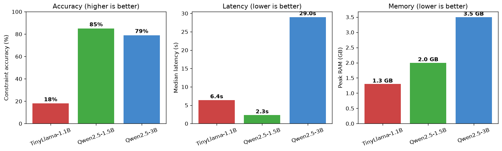

*GSoC 2026 • digiKam • Post 3: The Benchmark, and the Fine-Tuning Decision*

At the end of my last post I promised a comparison: Qwen2.5 against TinyLlama on real digiKam queries. This is that post. It grew a third model along the way, and the result surprised me enough that I want to walk through it honestly, because the tidy expectation I started with turned out to be wrong.

If you're just joining: in the [first post]() I introduced the goal - bringing natural-language search to digiKam, so you can find photos by describing them in plain English instead of filling in an advanced-search form. In the [second post]() I walked through actually wiring a local LLM into a desktop app, and the lesson that surprised me: the model was the *small* part, and the pipeline around it: the prompt, the parser, the dictionary that catches ambiguity, did most of the real work. This post picks up the thread I left there: is the model I chose actually the right one?

The question underneath all of this is a practical one. digiKam's natural language search runs a **local, quantized model** on the user's own machine, no cloud, no API, your photos and your queries never leave your computer. That constraint is the whole point of the feature, and it's also what makes model choice hard. You can't just reach for the biggest, best model; it has to load and run on an ordinary laptop, next to digiKam itself, fast enough that a search doesn't feel broken. So the real question isn't "which model is best," it's "which model is the right *balance* for this job."

I'd been running Qwen2.5-1.5B this whole time because it felt right. This post is me actually checking.

**What I measured, and how**

I built a small benchmark harness. It lives in `core/tests/llm/`, it's a standalone Python script, and it does three things for every query: measures **latency**, measures **peak memory**, and scores **structured-output accuracy**, whether the model produced the correct search constraints.

The one thing I cared about most was fidelity: the benchmark had to test the *real* pipeline, not a convenient approximation of it. So it uses the exact prompt digiKam sends, transcribed straight from `SearchPromptBuilder`, and it feeds the model the same way the C++ backend does, as a raw prompt with no chat-template wrapping. If the benchmark and the app disagreed on how they talked to the model, the numbers would be fiction.

The test set is about 40 hand-labelled queries. Each one pairs a plain-English request with the constraints it *should* produce: "photos from 2023 rated 5 stars" should give a date range and a rating. I scored at the level of the model's raw intent, before the resolver's later cleanup steps, because I wanted to measure the *model*, not the pipeline wrapped around it.

Which brings me to the first thing I got wrong.

**The benchmark caught my own mistakes first**

My first run scored Qwen at 66%. I almost believed it.

Then I read the failures, and most of them weren't the model. They were *me*, in the labels. I'd written that "pictures tagged sunset" should produce `tag` with the operator `contains`; the model produced `eq`; and when I checked the actual code, digiKam's tag matching ignores the operator entirely and looks the tag up by name. So the model was right, my expected answer was wrong, and my benchmark was confidently marking a correct output as a failure.

There were a handful like that. A caption operator I'd mislabelled. And a latency problem that turned out to be the harness, not the model: I was letting the model generate all the way to its token limit, when the real backend stops the moment it has a complete JSON object. The model had been producing a correct answer and then rambling on past it; the app already knew to stop reading, and my benchmark had forgotten to. It was the same "knowing when to shut up" issue from last post, except this time the mistake was mine, in the harness. Once I fixed it to stop at the first complete object the way the backend does, median latency dropped from about 15 seconds to under 2.

I'm telling you this because it's the most important thing the benchmark did. Before it could measure the model, it measured my assumptions, and several of them were wrong. A benchmark that only ever confirms what you expected isn't measuring anything. The 66% was noise; the real signal was underneath, once I stopped trusting my own labels and started checking them against what the code actually does.

The honest Qwen2.5-1.5B number, after fixing my labels, is **about 85%**.

**The three-way comparison**

I benchmarked three models, all as Q4_K_M quantized GGUFs so the comparison is fair, all getting the identical prompt:

- **TinyLlama-1.1B**, the lightweight baseline.
- **Qwen2.5-1.5B**, the model I'd been using.
- **Qwen2.5-3B**, added because I wanted to know: would a bigger model be *better*?

Here's what came back:

| Model | Constraint accuracy | Median latency | Peak RAM |
| ------------------ | ------------------: | -------------: | -------: |
| TinyLlama-1.1B     | 18%                 | ~6.4s          | ~1.3 GB  |
| **Qwen2.5-1.5B**   | **85%**             | **~2.3s**      | **~2.0 GB** |
| Qwen2.5-3B         | 79%                 | ~29s           | ~3.5 GB  |

I sat with that middle-and-bottom row for a while, because it's not what I expected.

  

**TinyLlama can't do the job**

At 18%, TinyLlama isn't close. And it's not failing gracefully, it's failing *weirdly*. It invents field names. It puts typos in values (`"accpeted"`). In several queries it copied the schema template literally into its output, the `null | { ... }` placeholder and all, producing JSON that doesn't parse. It's a small model being asked to do something structured, and it mostly can't hold the shape.

The pattern makes sense once you think about capacity. With only 1.1B parameters, TinyLlama doesn't have enough of a grip on the instruction to commit to one clean answer, so it hedges by generating *more* - more tokens, more variations, more noise. That also explains the thing I'd assumed wrong: I expected it to at least be *faster*, and it wasn't. It was slower than the 1.5B model, precisely because it rambles; it doesn't know when to stop, so it burns tokens generating garbage after the answer. Smaller model, worse latency, far worse accuracy. There's no axis on which it wins.

**And bigger didn't help**

This is the row I keep coming back to. I added Qwen2.5-3B expecting it to be the accuracy ceiling, the "here's what you get if you're willing to pay for it" option. Instead it scored *lower* than the 1.5B model, 79% against 85%, and it did it while taking thirteen times longer per query and using most of another gigabyte and a half of RAM.

The accuracy drop surprised me until I read the failures. The 3B model *over-thinks* simple structured tasks. On queries the 1.5B got right cleanly, the larger model would elaborate, add an extra constraint, reformat, second-guess, and break the exact match in the process. It even fumbled a couple of person queries the smaller model handled without blinking. More capacity, spent making a simple task complicated.

And the latency alone disqualifies it. A median of 29 seconds, with the first query taking 73, is simply not something you can put behind an interactive search box. Nobody types "red label photos" and waits half a minute. Even if the 3B had been *more* accurate, this number would have ended the discussion.

So the comparison brackets the choice from both sides. Too small can't do it. Too big is slower, heavier, and no better, sometimes worse. The 1.5B model sits in the middle and wins on the two things that actually matter together: accuracy *and* speed. It's not a compromise between them; it's genuinely the best on both among viable options.

**Where Qwen still gets things wrong**

85% isn't 100%, and the 15% is worth looking at, because it decided the next question.

Qwen's errors aren't scattered. They cluster, tightly, in two places. **Orientation**: it reads "portrait" as a subject tag rather than an image orientation, and it doesn't map "horizontally" to "landscape." And **date structure**: occasionally it uses the wrong operator on a date range. That's essentially it. Everything else, ratings, labels, people, places, albums, composite queries with three constraints at once, it handles reliably.

And here's the thing I already knew before the benchmark, now confirmed with numbers: **those exact weak spots are the ones the pipeline already handles.** Take the "portrait" slip. The model tags it as a subject; but `SearchCapabilityDictionary` recognises "portrait" as an ambiguous orientation term and maps it to the right field, and `SearchIntentResolver` validates the whole constraint before anything runs. The model's mistake never reaches the search. The model's blind spots and the pipeline's safety net line up almost perfectly, which is a good sign that the pipeline was built around the right risks.

**The question I actually had to answer: fine-tune or not?**

My proposal left a decision open for this stage. If the benchmark turned up a recurring class of errors that prompting couldn't fix, I'd spend the time on a lightweight LoRA fine-tune, curate a dataset, train an adapter on Qwen2.5-1.5B, convert it back to GGUF, and re-benchmark. If prompting was already good enough, I'd document that and spend the time on polish instead.

The 3B result is what settled it, and settled it more cleanly than I expected.

The residual errors, orientation and dates, are the *same* in the 3B model as in the 1.5B. Doubling the parameters didn't fix them. That tells me something specific: these aren't a capacity problem. If they were, a bigger model would have done better on exactly these cases, and it didn't. They're a *prompting and vocabulary* problem, "portrait" is genuinely ambiguous, "horizontally" is genuinely non-standard, and the fix for that kind of thing is a clearer prompt and a dictionary entry, not more model.

And I already have both. The prompt rules and the dictionary already catch these cases downstream in the real system. So a LoRA would be training a model to fix errors that a bigger model *also* makes, that aren't about model size, and that the pipeline already handles.

There's a second cost, too, beyond the missing benefit. A fine-tune isn't free to keep. It means maintaining a curated training set, retraining every time the base model updates, and re-running the GGUF conversion each time, real ongoing overhead for the project. For a problem that a prompt line and a dictionary entry already solve, that complexity isn't justified.

So: **no fine-tuning.** Not because I ran out of time, but because the evidence says it wouldn't help. That feels like the right kind of conclusion to reach, the one backed by the data rather than the one I assumed going in.

**One more thing the benchmark showed**

There's a category of query where every model, including Qwen, "fails" on paper, and I want to be clear about why that's fine.

Ask any of these models, on their own, to handle "videos longer than 5 minutes" (a field digiKam's search didn't support at the time) or "asdfghjkl" (nonsense), and they guess. They invent a constraint. The raw model does not know how to say "I can't do that", small models are famously bad at refusing, and I wrote about that in the last post too.

But in the actual system, the model never gets the last word. The parser whitelists every field, so an invented field is rejected, not executed. The dictionary flags ambiguity. The model proposing something wrong and the system *accepting* it are two different events, and the whole architecture exists to keep the second one from happening. The benchmark scoring these as model-level failures is correct, and it's also exactly why the layers around the model are there. A model you can't fully trust is fine, as long as nothing downstream trusts it blindly.

**Key takeaways**

- **The middle model won.** For structured extraction on a CPU, 1.5B was the sweet spot: too-small couldn't hold the format, too-big was slower and no more accurate. Bigger is not automatically better.
- **Check your benchmark before you trust it.** My first run scored 66%; most of the failures were wrong labels of mine, not model errors. A benchmark measures your assumptions first.
- **Match the app exactly.** Same prompt, same raw inference, same stop condition. A benchmark that talks to the model differently from the app is measuring a different system.
- **The errors that remain aren't a capacity problem.** A 2x-larger model made the same orientation and date mistakes, which is how I know they're prompting issues, already handled, and not something fine-tuning would fix.
- **No LoRA, on purpose.** The decision my proposal left open is now closed by evidence: prompting plus the dictionary is sufficient, and the benchmark data says so.

**Where things stand**

The model choice is validated, with numbers behind it now instead of a hunch. The benchmark is in the tree at `core/tests/llm/`, with the dataset, a runner script, and a results write-up, so anyone can reproduce it or extend it with new queries. To run it yourself, see the README there. It's the kind of thing the next person to touch this feature will be glad exists, which is the whole reason it's committed rather than living in a notebook on my laptop.

**What's next**

- **More search properties.** Video duration, frame rate, bitrate, and file format, the fields the model didn't map yet. (I've since started adding these, and they extend the same way every existing field did: a prompt rule, a dictionary entry, a parser whitelist, and a branch that writes the search field.)
- **User documentation.** A natural-language-search section for the digiKam handbook, so the feature is discoverable by the people it's actually for.
- **Polish and merge.** Readying the branch for the 9.2.0 release, so this can go out to real users for beta testing.

