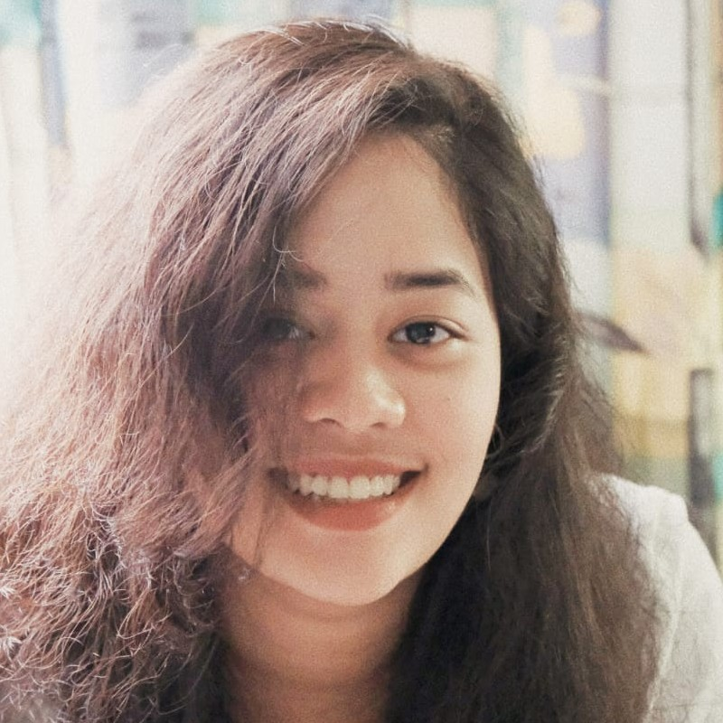
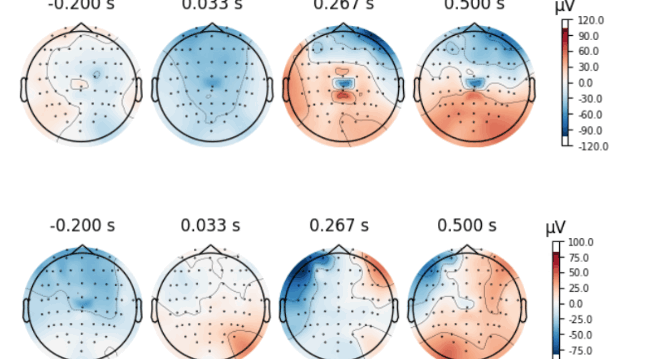
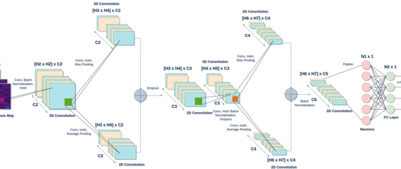
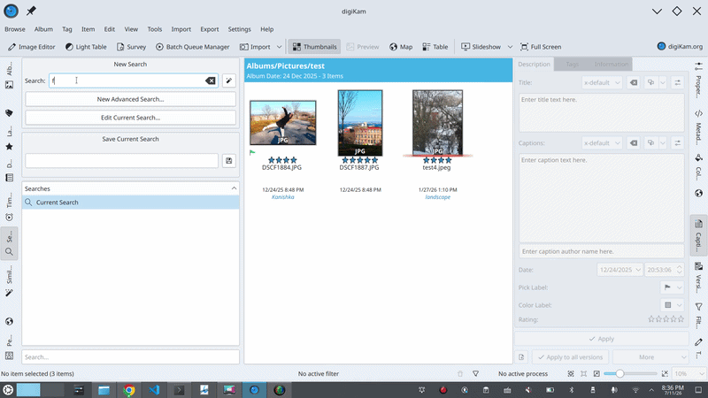
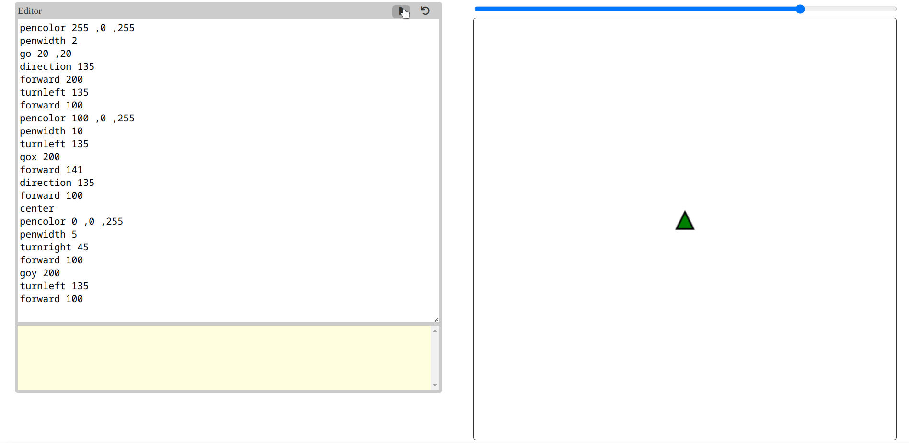
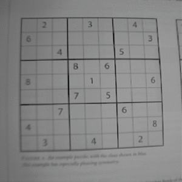
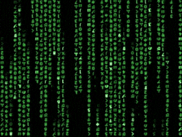

  <h1 style="margin: 0;">Srirupa Datta</h1>
  

 

Hi, I am Srirupa (IRC: sriru:matrix.org). I am currently a second-year Master's student in Computer Science at the [Courant Institute of Mathematical Sciences, NYU](https://cs.nyu.edu/home/index.html), interested in pursuing research in Computer Science. My research interests focus on the intersection of deep learning, computer vision, and reinforcement learning. 

Alongside my courses, I am contributing to [digiKam](https://www.digikam.org/) (KDE) as part of [Google Summer of Code 2026](https://summerofcode.withgoogle.com/programs/2026/projects/qyiUD0bH), building an LLM-assisted natural-language search feature that maps plain-English queries into structured search criteria (mentored by Gilles Caulier). Before joining NYU, I worked as a Software Engineer at Morgan Stanley (2023–2025), where I modernized legacy ETL pipelines, led large-scale data migration to Snowflake, and built full-stack application features using Python and Angular. In the summer of 2023, I also contributed to Krita (KDE) as part of [Google Summer of Code](https://summerofcode.withgoogle.com/archive/2023/projects/SB6pWpuy) under the mentorship of Emmet O'Neill, redesigning Krita's Bundle Creator, a tool that enables users to create compressed files called Resource Bundles, which house collections of resources, and adding the capability to edit these bundles.

Before my graduation, I worked with [Prof. Amit Konar](https://scholar.google.co.in/citations?user=s1F23CAAAAAJ&hl=en) and [Prof. Sanjoy Kumar Saha](https://scholar.google.co.in/citations?user=X3Cu3hYAAAAJ&hl=en) on research projects that deepened my knowledge of deep learning and signal processing, including work on motor imagery classification from EEG signals. As a painter with a passion for software development, I actively contributed to Krita while also engaging myself in learning and practicing digital painting. During my undergraduate years, I had the opportunity to intern at [Simon Fraser University](https://www.sfu.ca/) in the summer of 2022 through the [Mitacs Globalink Fellowship](https://www.mitacs.ca/our-programs/globalink-research-internship-students/), where I gained research experience in EEG-based brain age classification. I graduated from [Jadavpur University](https://jadavpuruniversity.in/), India, in 2023 with a Bachelor's degree in Electrical Engineering.

  
<a href="mailto:srirupa.sps@gmail.com">Email</a>  /  
<a href="https://drive.google.com/file/d/1Vs1ARMm-Q5m9TeAnWasNLkoTX3CtFJaz/view?usp=sharing">CV</a>  /  
<a href="https://scholar.google.com/citations?hl=en&user=UV_Jyr0AAAAJ">Google Scholar</a>  /  
<a href="https://www.github.com/srirupa19">GitHub</a>  /  
<a href="https://www.linkedin.com/in/srirupa-datta-a89a90405/">LinkedIn</a>  

<h3 style="color: #0074D9;">Research</h3>

 

  <!-- Image or Animation on the left -->
  
  
  <!-- Text on the right -->
  

    <b>Motor Imagery Classification Using Activation/Deactivation Pattern Created from EEG Signal</b>
     
    <i>Rahash Agarwal, <b>Srirupa Datta</b>, Debatri Chatterjee, Sanjoy Kumar Saha</i>
     
    IEEE APSCON'25
     
    <!-- Link at the bottom of the text -->
    [<a href="https://drive.google.com/file/d/17O2kqI7DtxLB-XtFqaH6o4vpqYGXkivS/view?usp=sharing" target="_blank">Paper</a>] 
    []  
    
  

 

  <!-- Image or Animation on the left -->
  

  <!-- Text on the right -->
  

    <b>A Deep Learning Approach for Position Control of a Mobile Robot</b>
     
    <i><b>Srirupa Datta</b>, Swapnil Sengupta, Tamodip Das, Sourya Dasgupta, Sayantani Ghosh, Amit Konar</i>
     
    CODEC'23
     
    <!-- Link at the bottom of the text -->
    [<a href="https://ieeexplore.ieee.org/document/10466131">Paper</a>] 
    [<a href="https://github.com/srirupa19/EEG_Motor_Imagery">Code</a>]  
  

<h3 style="color: #0074D9;">Work Experience</h3>

  <!-- Image or Animation on the left -->
  
  
  <!-- Text on the right -->
  

    <h5>Google Summer of Code, 2026</h5>
    
 Worked on an LLM-assisted natural-language search feature for digiKam that lets users type plain-English queries and maps them into editable Advanced Search criteria using a local lightweight model, validated intent parsing, ambiguity handling, caching, and the existing XML-to-SQL search pipeline.

    
    <!-- Link at the bottom of the text -->
    [<a href="https://community.kde.org/GSoC/2026/StatusReports/SrirupaDatta" target="_blank">About</a>] 
    [<a href="https://invent.kde.org/srirupa/digikam/-/merge_requests/1">Code</a>]  
    
  

  <!-- Image or Animation on the left -->
  
  
  <!-- Text on the right -->
  

    <h5>Morgan Stanley, Software Engineer II</h5>
    <i>Aug 2023 - Aug 2025</i>
    
As part of the Institutional Securities Department, worked on data transformation projects migrating finance reference data to Snowflake (Azure) and developed Jenkins-based CI/CD pipelines for automated deployments. Contributed to optimizing legacy ETL functionality by converting Perl code to Python and improving performance with PySpark, while also enhancing a full-stack application using Python, Flask, and Angular.

    
    <!-- Link at the bottom of the text -->
    <!-- [<a href="https://community.kde.org/GSoc/2023/StatusReports/SrirupaDatta" target="_blank">About</a>] 
    [<a href="https://invent.kde.org/graphics/krita/-/merge_requests/1802">Code</a>]   -->
    
  

  <!-- Image or Animation on the left -->
  
  
  <!-- Text on the right -->
  

    <h5>Google Summer of Code, 2023</h5>
    
Redesigned Krita’s Bundle Creator into a resizable wizard with four distinct pages, improving its modularity and user interface. This tool allows users to create, manage, and edit resource bundles, with enhanced features like resource filtering, grid/list view toggling, and integration with Krita's Resource Database.

    
    <!-- Link at the bottom of the text -->
    [<a href="https://community.kde.org/GSoc/2023/StatusReports/SrirupaDatta" target="_blank">About</a>] 
    [<a href="https://invent.kde.org/graphics/krita/-/merge_requests/1802">Code</a>]  
    
  

  <!-- Image or Animation on the left -->
  
  
  <!-- Text on the right -->
  

    <h5>Morgan Stanley, Technology Analyst Intern, 2022</h5>
    
Worked on a firm-wide Greenplum decommission project, migrating from on-premises Greenplum to Snowflake (Azure) to optimize cost efficiency. Developed scripts to automate the migration of stage and dimension tables, greatly reducing manual effort and streamlining the process for Cost Reporting and Balance Sheet.

    
    <!-- Link at the bottom of the text -->
    <!-- [<a href="https://community.kde.org/GSoc/2023/StatusReports/SrirupaDatta" target="_blank">About</a>] 
    [<a href="https://invent.kde.org/graphics/krita/-/merge_requests/1802">Code</a>]   -->
    
  

  <!-- Image or Animation on the left -->
  
  
  <!-- Text on the right -->
  

    <h5>Season of KDE, 2022</h5>
    
Developed a Perspective Ellipse Assistant in Krita that is used for accurately drawing ellipses within a square, ensuring proper alignment in perspective. This tool streamlines the process by automating perspective projection, enhancing precision and efficiency in digital art creation.

    
    <!-- Link at the bottom of the text -->
    [<a href="https://community.kde.org/SoK/2022/StatusReport/Srirupa_Datta" target="_blank">About</a>] 
    [<a href="https://invent.kde.org/graphics/krita/-/merge_requests/1343">Code</a>]  
    
  

<h3 style="color: #0074D9;">Honors and Awards</h3>

- [May, 2022] [Mitacs Globalink Research Internship](https://www.mitacs.ca/our-programs/globalink-research-internship-students/), awarded to top-ranked applicants from 15 different countries, offering a 12-week research opportunity at Canadian universities.
- [October, 2019] [JBNSTS Bigyani Kanya Scholarship](https://jbnsts.ac.in/), 4-year scholarship for academic excellence awarded to the top 50 girls of the state.
- [June, 2019] [Joint Entrance Examination Main](https://jeemain.nta.nic.in/), secured All India Rank 4588 among 9.5 million
candidates
- [December, 2017] [KVPY](https://en.wikipedia.org/wiki/Kishore_Vaigyanik_Protsahan_Yojana), national research fellowship scholarship awarded to top students during senior high school

<h3 style="color: #0074D9;">Open Source Contributions</h3>
Being a painter who loves coding, I’ve been using Krita to paint since my undergrad days. I’ve been using KDE software since 2021, and in my free time I like giving back to the tools I use, mostly Krita and digiKam. Below are some of the PRs I’ve worked on.

- [PR !380 (digiKam)](https://invent.kde.org/graphics/digikam/-/merge_requests/380):   Added Advanced Search support for finding images with missing or empty capture settings and place metadata, helping identify photos with incomplete EXIF or location information.

- [PR !801 (Krita)](https://invent.kde.org/graphics/krita/-/merge_requests/801):  Added a warning dialog when exporting files with multiple transparency masks to formats that do not support them, preventing silent data loss.

- [PR !894 (Krita)](https://invent.kde.org/graphics/krita/-/merge_requests/894):  Fixed a freeze when splitting layers on a colorize mask by converting it to a paint layer, improving performance.

- [PR !883 (Krita)](https://invent.kde.org/graphics/krita/-/merge_requests/883):  Fixed incorrect brush previews for brushes without preview images by correcting the drawing order in the preview view.

- [PR !854 (Krita)](https://invent.kde.org/graphics/krita/-/merge_requests/854): Removed an unnecessary and ambiguous “work recursively” option and cleaned up the related code in the transform tool.

- [PR !795 (Krita)](https://invent.kde.org/graphics/krita/-/merge_requests/795):  Reordered the touch docker to make the interface more intuitive.

- [PR !886 (Krita)](https://invent.kde.org/graphics/krita/-/merge_requests/886):  Fixed swapped Y-axis labels in the brush mix transfer curve.

<h3 style="color: #0074D9;">Fun Projects</h3>

  <!-- Cell 1 -->
  

    

      
    

     
    
<a href="https://github.com/srirupa19/kturtle" target="_blank">KTurtle Clone </a>

  

  
  <!-- Cell 2 -->
  

    

      
    

     
    
<a href="https://github.com/srirupa19/Sudoku" target="_blank">Sudoku Solver</a>

  

  
  <!-- Cell 3 -->
  

    

      
    

     
    
<a href="https://github.com/srirupa19/Interpreter" target="_blank">Interpreter</a>

  

